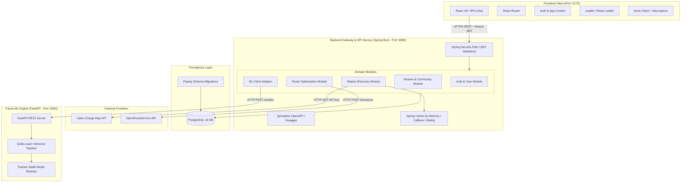
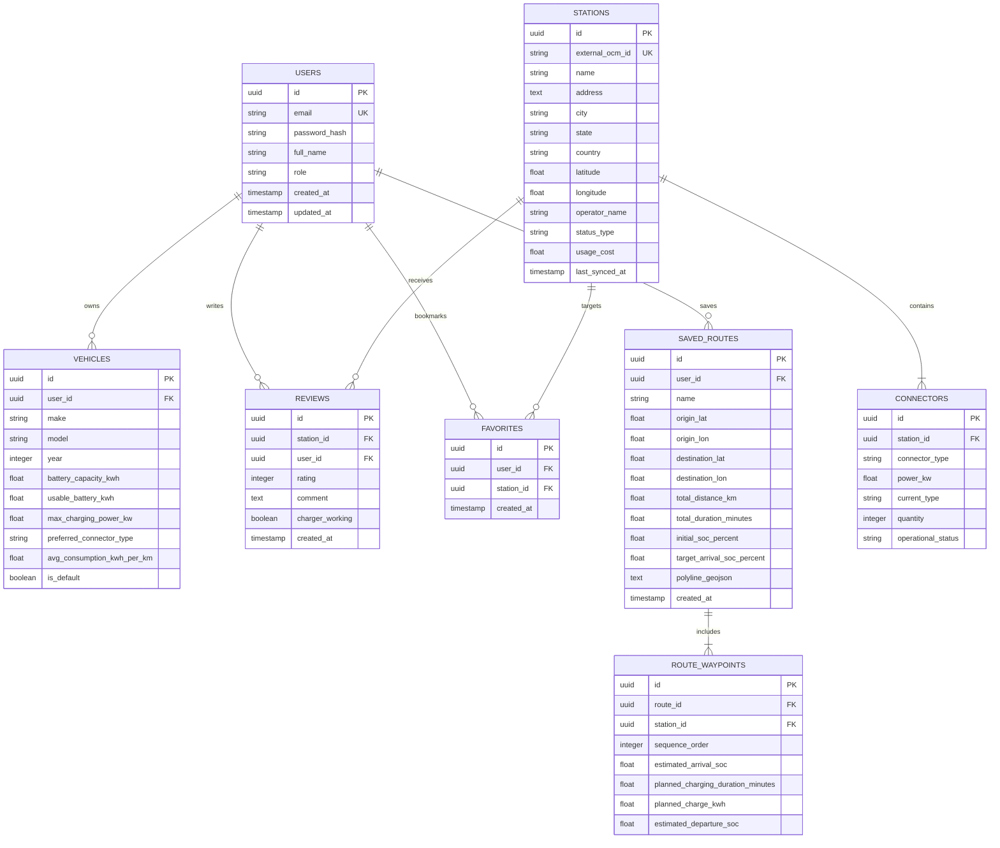

# VoltRoute: System Architecture & Design Specification

## 1. Architectural Strategy & Design Principles

VoltRoute is designed using a **Clean Modular Monolith** architecture for the primary backend, paired with an independent **Single Page Application (SPA)** frontend, and an asynchronous or REST-integrated **AI/ML Microservice**.



### 1.1 Core Design Principles
* **Separation of Concerns**: Strict boundaries between presentation (React SPA), orchestration/business logic (Spring Boot), data persistence (PostgreSQL/Hibernate), and numerical inference (Python FastAPI).
* **Stateless Security**: Zero HTTP session state on the backend; all authenticated requests are validated via cryptographic JSON Web Tokens (JWT) passing claims and user identity.
* **Resilient External Integrations**: External third-party APIs (Open Charge Map and OpenRouteService) are isolated behind dedicated Gateway/Client adapters with caching, timeout handling, and fallback capabilities to prevent cascading service degradation.
* **Hexagonal / Clean Domain Organization**: Domain entities and business logic remain decoupled from transport-specific layers (Controllers and DTOs).

---

## 2. Component Breakdown

> [!NOTE]
> The directory layouts (`frontend/`, `backend/`, and `ml-service/`) documented below represent the planned target architecture. The workspace root is currently greenfield and contains only the `docs/` directory; application components will be scaffolded in Phase 0 (and Phase 7 for the ML microservice).

### 2.1 Planned Frontend Architecture (`frontend/`)
* **React + Vite**: Fast build toolchain, Hot Module Replacement (HMR), optimized client bundle.
* **Tailwind CSS**: Utility-first responsive design supporting dark/light mode and mobile/desktop viewport adaptations.
* **Leaflet & React Leaflet**: GIS canvas rendering tile layers from OpenStreetMap, high-performance rendering of charging station pins, clustered markers, and animated route polylines.
* **State & Authentication Flow**:
  * `AuthContext` provides global user identity, token storage (`localStorage` / secure cookies), and permission state.
  * Axios HTTP Interceptors automatically attach `Authorization: Bearer <token>` to outbound requests and handle `401 Unauthorized` responses via token refresh or redirection to login.
* **Router Structure**:
  * `/`: Interactive Map & Station Discovery.
  * `/login` & `/register`: Authentication portal.
  * `/route-planner`: Advanced EV trip calculation and charging halt itinerary.
  * `/stations/:id`: Station details, real-time status, reviews, and check-ins.
  * `/profile`: User vehicle garage and saved favorite routes/stations.

### 2.2 Backend Architecture (`backend/`)
Built with **Spring Boot 3.5.x** running on **Java 21 LTS**, structured into package-by-feature domain slices:

```
backend/
├── src/main/java/com/voltroute/
│   ├── VoltRouteApplication.java
│   ├── config/                     # Security, CORS, OpenAPI, WebClient configs
│   ├── security/                   # JWT provider, filter, UserDetails service
│   ├── common/                     # Global exception handlers, base responses, utilities
│   ├── modules/
│   │   ├── auth/                   # Registration, login, password encryption
│   │   ├── user/                   # User profile, EV vehicle garage management
│   │   ├── station/                # Station queries, OCM client, connector models
│   │   ├── route/                  # ORS client, battery simulation, halt solver
│   │   ├── review/                 # Community reviews, ratings, favorites
│   │   └── ml/                     # ML client adapter & DTOs
│   └── external/
│       ├── ocm/                    # Open Charge Map integration client & DTOs
│       └── ors/                    # OpenRouteService integration client & DTOs
└── src/main/resources/
    ├── application.yml             # Main configuration with env-var placeholders
    ├── application-dev.yml         # Local development configuration
    └── db/migration/               # Flyway SQL migration scripts
```

### 2.3 Machine Learning Microservice (`ml-service/`)
A dedicated Python service encapsulating computational intelligence tasks:
* **Wait-Time Prediction**: Predicts queue latency at a given charging station given historical arrival logs, time-of-day, day-of-week, and connector type.
* **Battery Consumption & Charging Curve Model**: Models non-linear charging rates (fast charging from 10% to 80%, tapering off from 80% to 100%) and vehicle energy discharge based on route elevation and speed.

---

## 3. Database & Data Modeling

The relational persistence tier is hosted on **PostgreSQL 18**. 



---

## 4. Security & Credential Architecture

### 4.1 Authentication & Authorization
* **Password Security**: Passwords hashed using standard `BCryptPasswordEncoder` with strength factor 12.
* **Stateless Tokens**: Signed using `HMAC-SHA256` or `RSA` with an expiration window (e.g., 24 hours access token, optional refresh token rotation).
* **Role-Based Access Control (RBAC)**:
  * `ROLE_USER`: Query stations, calculate routes, manage owned vehicles, write reviews, bookmark stations.
  * `ROLE_ADMIN`: Station metadata override, user moderation, system configuration.

### 4.2 Credential Protection & Configuration Policy
* **Zero Hardcoded Secrets**: All sensitive keys, database passwords, and third-party API tokens must be injected via environment variables or `.env` files (never checked into version control).
* **Config Template**: A sanitized `.env.example` file will be provided as a Phase 0 deliverable, documenting expected environment variable names without actual secrets:
  * `POSTGRES_DB`
  * `POSTGRES_USER`
  * `POSTGRES_PASSWORD`
  * `JWT_SECRET`
  * `OPEN_CHARGE_MAP_API_KEY`
  * `OPENROUTESERVICE_API_KEY`
  * `ML_SERVICE_URL`
* **CORS Policy**: Configured explicitly to allow origins matching the frontend client URL (`http://localhost:5173` in local development) with allowed headers (`Authorization`, `Content-Type`) and credentials support.

---

## 5. Integration Architecture

### 5.1 Open Charge Map (OCM) Integration
* **Protocol**: REST over HTTPS.
* **Endpoint Pattern**: `GET /v3/poi/?output=json&latitude={lat}&longitude={lon}&distance={km}&distanceunit=KM&maxresults={limit}&key={API_KEY}`.
* **Resilience Strategy**:
  * Results are cached locally in Spring Cache with a configurable Time-To-Live (TTL) (e.g., 6 hours) based on geospatial geohashes or rounded coordinate grids.
  * Stations are persisted in PostgreSQL to enable offline search and localized reviews.

### 5.2 OpenRouteService (ORS) Integration
* **Protocol**: REST over HTTPS.
* **Endpoint Pattern**: `POST /v2/directions/driving-car/geojson`.
* **Payload**: Coordinates list `[[start_lon, start_lat], [end_lon, end_lat]]` with optional extra information (`elevation=true`, `extra_info=["steepness", "waytype"]`).
* **Algorithm for EV Stop Insertion**:
  1. Calculate base direct route and total required energy:
     $$\text{Total Energy (kWh)} = \text{Distance (km)} \times \text{Avg Consumption (kWh/km)} + \Delta \text{Elevation Factor}$$
  2. If $\text{Initial Battery kWh} - \text{Total Energy} < \text{Target Arrival Battery kWh}$, identify critical battery exhaustion thresholds along the route polyline.
  3. Query candidate stations within a buffer radius (e.g., 5-10 km) of the polyline near the threshold.
  4. Filter candidates by vehicle connector compatibility and maximum charging power.
  5. Inject the selected station as a waypoint and recalculate route segments.

---

## 6. Layered Architecture, Error Handling & API Conventions

### 6.1 Package Organization
The backend follows a domain-driven layered architecture:
```
com.voltroute
├── config                          # Infrastructure configs (Security, OpenAPI, CORS, WebMvc)
├── security                        # Security handlers, entry points, and JWT infrastructure
├── common
│   ├── response                    # Standard API and Error response envelopes (ApiResponse, ApiErrorResponse)
│   └── exception                   # Domain exceptions and centralized GlobalExceptionHandler
└── modules
    ├── health                      # Liveness/Readiness probes (HealthController, HealthService, HealthResponseDto)
    └── user                        # User identity, roles, vehicle garage, and favorite bookmarks
```

### 6.2 Standardized Response Envelopes
All REST endpoints adhere to uniform response structures:

* **Success Response (`ApiResponse<T>`)**:
  ```json
  {
    "success": true,
    "status": 200,
    "message": "Service operational",
    "data": { ... },
    "timestamp": "2026-10-28T11:47:44.226Z"
  }
  ```

* **Error Response (`ApiErrorResponse`)**:
  ```json
  {
    "success": false,
    "status": 400,
    "error": "Validation Failed",
    "message": "Input validation failed. See 'validationErrors' for details.",
    "path": "/api/users",
    "timestamp": "2026-10-28T11:47:44.226Z",
    "validationErrors": {
      "email": "Invalid email format",
      "password": "Password cannot be blank"
    }
  }
  ```

### 6.3 Centralized Exception Handling (`GlobalExceptionHandler`)
The platform uses `@RestControllerAdvice` to translate all exceptions into standardized `ApiErrorResponse` objects:
* `ResourceNotFoundException` $\rightarrow$ `404 Not Found`
* `BadRequestException` $\rightarrow$ `400 Bad Request`
* `ConflictException` $\rightarrow$ `409 Conflict`
* `UnauthorizedException` / `BadCredentialsException` $\rightarrow$ `401 Unauthorized`
* `AccessDeniedException` $\rightarrow$ `403 Forbidden`
* `MethodArgumentNotValidException` & `ConstraintViolationException` $\rightarrow$ `400 Bad Request` with field-level map
* `HttpMessageNotReadableException` $\rightarrow$ `400 Bad Request` (Malformed JSON)
* `HttpRequestMethodNotSupportedException` $\rightarrow$ `405 Method Not Allowed`
* `Exception` (catch-all) $\rightarrow$ `500 Internal Server Error` (sanitized user message; stack trace logged securely)

### 6.4 Security & JWT Compatibility Architecture
* **Stateless Security**: `SessionCreationPolicy.STATELESS` with CSRF disabled for REST clients.
* **Strict Endpoint Authorization**:
  * Publicly permitted: `/api/health`, `/actuator/**`, `/v3/api-docs/**`, `/swagger-ui/**`, `/swagger-ui.html`, `/api/auth/**`.
  * All business endpoints require authentication: `anyRequest().authenticated()`.
* **Authentication Entry Point**: `JwtAuthenticationEntryPoint` intercepts unauthenticated requests, returning standard `ApiErrorResponse` JSON with HTTP 401 instead of default HTML error pages.
* **OpenAPI JWT Integration**: SpringDoc OpenAPI declares the `bearerAuth` security scheme, displaying the interactive Authorization dialog in Swagger UI.

---

## 7. Architecture Decision Records (ADR) Summary

* **ADR 01: Modular Monolith vs. Microservices for Core Backend**: Selected Spring Boot Modular Monolith to avoid premature distributed systems complexity while maintaining strict domain package isolation.
* **ADR 02: Python FastAPI for ML**: Segregated Python for ML modeling while keeping Java Spring Boot for high-throughput enterprise API gateway and transactional business workflows.
* **ADR 03: Leaflet over Google Maps SDK**: Chosen Leaflet with OpenStreetMap to ensure open-source licensing, no billing lock-in, and full control over custom marker layers and SVG icons.
