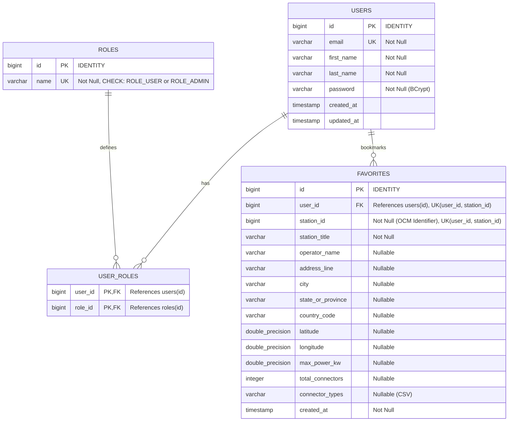

# VoltRoute: Database Design & PostgreSQL Integration Specification

## 1. Overview & Architecture

VoltRoute uses **PostgreSQL** as its primary relational database management system (RDBMS) paired with **Spring Data JPA** and **Hibernate 6** on the Spring Boot backend.

The database is designed to handle user authentication, vehicle garage specifications, station favorites, crowd-sourced reviews, and multi-stop planned itineraries with relational integrity, ACID guarantees, and non-destructive schema evolution.

---

## 2. Environment Configuration & Externalization

All database connection parameters are fully externalized and configured through environment variables or system properties. **No credentials are hardcoded or printed to application logs.**

### 2.1 Configuration Keys & Defaults

| Property | Environment Variable | Development Default | Description |
| :--- | :--- | :--- | :--- |
| `spring.datasource.url` | `SPRING_DATASOURCE_URL` or `POSTGRES_HOST`, `POSTGRES_PORT`, `POSTGRES_DB` | `jdbc:postgresql://localhost:5432/voltroute_db` | JDBC connection URL |
| `spring.datasource.username` | `SPRING_DATASOURCE_USERNAME` or `POSTGRES_USER` | `postgres` | Database user account |
| `spring.datasource.password` | `SPRING_DATASOURCE_PASSWORD` or `POSTGRES_PASSWORD` | *(None / Required in dev)* | Database user password |
| `spring.datasource.driver-class-name` | &mdash; | `org.postgresql.Driver` | PostgreSQL JDBC driver |
| `spring.datasource.hikari.maximum-pool-size` | &mdash; | `10` | Maximum connections in pool |
| `spring.datasource.hikari.minimum-idle` | &mdash; | `2` | Minimum idle connections |
| `spring.datasource.hikari.connection-timeout` | &mdash; | `10000` (10s) | Connection acquisition timeout |
| `spring.jpa.hibernate.ddl-auto` | &mdash; | `update` (dev) / `create-drop` (test) | Non-destructive schema strategy |

### 2.2 Profile Architecture
* **`local` Profile** ([`application-local.yml`](file:///backend/src/main/resources/application-local.yml)): Uses an embedded, in-memory H2 database in PostgreSQL mode (`jdbc:h2:mem:voltroute_local;MODE=PostgreSQL`). Ideal for zero-dependency local runs and UI development without requiring PostgreSQL installed.
* **`dev` Profile** ([`application-dev.yml`](file:///backend/src/main/resources/application-dev.yml)): Connects to the local PostgreSQL instance (`voltroute_db`). Fails fast with clear authentication errors if credentials are missing or incorrect.
* **`test` Profile** ([`application-test.yml`](file:///backend/src/test/resources/application-test.yml)): Isolated in-memory H2 database with `create-drop` schema recreation for repeatable unit and repository testing.

---

## 3. Database Setup & Initialization Guide

To initialize PostgreSQL for VoltRoute on a new workstation:

### Step 1: Verify PostgreSQL Service
Ensure PostgreSQL service is running:
```powershell
# Windows
Get-Service -Name *postgres*
```

### Step 2: Create Database and User
Connect to PostgreSQL using `psql` or pgAdmin as the administrative user:

```bash
# Connect to PostgreSQL prompt
psql -U postgres -h localhost -p 5432
```

Execute SQL commands to provision the database:
```sql
-- Create database if not already present
CREATE DATABASE voltroute_db
    WITH OWNER = postgres
    ENCODING = 'UTF8'
    LC_COLLATE = 'English_India.1252'
    LC_CTYPE = 'English_India.1252'
    TABLESPACE = pg_default
    CONNECTION LIMIT = -1;

-- Grant all privileges
GRANT ALL PRIVILEGES ON DATABASE voltroute_db TO postgres;
```

### Step 3: Test Database Connectivity
Verify connection using the command line:
```bash
# Test connection using password
psql -U postgres -h localhost -p 5432 -d voltroute_db -c "\l"
```

---

## 4. Physical Schema & Entity Data Dictionary



### 4.1 Table: `users`
Represents registered users in the VoltRoute platform. Mapped to [`com.voltroute.modules.user.domain.User`](file:///backend/src/main/java/com/voltroute/modules/user/domain/User.java).

| Column | SQL Type | Constraints | Description |
| :--- | :--- | :--- | :--- |
| `id` | `bigint` | Primary Key, Generated by default as identity | Unique user identifier |
| `email` | `varchar(255)` | Not Null, Unique (`uk_users_email`) | User login email address |
| `first_name` | `varchar(255)` | Not Null | User first name |
| `last_name` | `varchar(255)` | Not Null | User surname / family name |
| `password` | `varchar(255)` | Not Null | BCrypt salted hash |
| `created_at` | `timestamp(6)` | Nullable | Record creation timestamp (via `@PrePersist`) |
| `updated_at` | `timestamp(6)` | Nullable | Last update timestamp (via `@PreUpdate`) |

### 4.2 Table: `roles`
Role-based access control (RBAC) tiers. Mapped to [`com.voltroute.modules.user.domain.Role`](file:///backend/src/main/java/com/voltroute/modules/user/domain/Role.java).

| Column | SQL Type | Constraints | Description |
| :--- | :--- | :--- | :--- |
| `id` | `bigint` | Primary Key, Generated by default as identity | Unique role identifier |
| `name` | `varchar(255)` | Not Null, Unique, Check constraint: `'ROLE_USER', 'ROLE_ADMIN'` | Role authority identifier |

### 4.3 Table: `user_roles`
Many-to-many relationship join table linking users to assigned system roles.

| Column | SQL Type | Constraints | Description |
| :--- | :--- | :--- | :--- |
| `user_id` | `bigint` | Foreign Key $\rightarrow$ `users(id)`, Composite PK | Assigned user |
| `role_id` | `bigint` | Foreign Key $\rightarrow$ `roles(id)`, Composite PK | Assigned role |

### 4.4 Table: `favorites`
User bookmarks for preferred EV charging stations. Mapped to [`com.voltroute.modules.favorite.domain.Favorite`](file:///backend/src/main/java/com/voltroute/modules/favorite/domain/Favorite.java).

| Column | SQL Type | Constraints | Description |
| :--- | :--- | :--- | :--- |
| `id` | `bigint` | Primary Key, Generated by default as identity | Unique favorite record ID |
| `user_id` | `bigint` | Foreign Key $\rightarrow$ `users(id)`, Not Null, Part of Unique Constraint | User who bookmarked the station |
| `station_id` | `bigint` | Not Null, Part of Unique Constraint | External station identifier (Open Charge Map ID) |
| `station_title` | `varchar(255)` | Not Null | Human-readable station title |
| `operator_name` | `varchar(255)` | Nullable | Charging network operator name |
| `address_line` | `varchar(255)` | Nullable | Physical street address |
| `city` | `varchar(100)` | Nullable | Municipality or city |
| `state_or_province` | `varchar(100)` | Nullable | State, province, or region |
| `country_code` | `varchar(10)` | Nullable | ISO 2-letter country code |
| `latitude` | `double precision` | Nullable | Geographic latitude coordinate |
| `longitude` | `double precision` | Nullable | Geographic longitude coordinate |
| `max_power_kw` | `double precision` | Nullable | Peak charging power in kW |
| `total_connectors` | `integer` | Nullable | Total connector bays available |
| `connector_types` | `varchar(500)` | Nullable | Comma-delimited supported plug standards |
| `created_at` | `timestamp(6)` | Not Null | Timestamp when bookmark was created |

#### Table Constraints & Indexes
* **Unique Constraint**: `uk_favorites_user_station` on `(user_id, station_id)` ensures a user cannot duplicate the same charging station bookmark.
* **Foreign Key**: `fk_favorites_user` on `user_id` referencing `users(id)` with cascading removal when an account is deleted.
* **Indexes**:
  * `idx_favorites_user_id` on `user_id` for $O(1)$ fast retrieval of all bookmarked favorites for the authenticated user.
  * `idx_favorites_station_id` on `station_id` for external station lookup.

---

## 5. Non-Destructive Schema & Hibernate DDL Policy

VoltRoute enforces a **strict non-destructive database evolution policy**:

1. **`spring.jpa.hibernate.ddl-auto: update` in Development**:
   * Hibernate reads existing PostgreSQL tables, column types, and constraints.
   * Only missing columns or tables are created automatically.
   * Existing columns, foreign keys, tables, and rows are **never dropped, deleted, or truncated**.
2. **Explicit Verification of Entities**:
   * Entity mappings in Java strictly mirror the database schema (e.g., `Long` $\leftrightarrow$ `bigint`, `IDENTITY` generation strategy $\leftrightarrow$ `generated by default as identity`).
3. **Repository Layer Verification**:
   * Automated tests in [`UserRepositoryTest`](file:///backend/src/test/java/com/voltroute/UserRepositoryTest.java) verify transactional CRUD operations without polluting persistent development or production databases.
