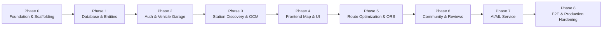

# VoltRoute: Phased Implementation Plan

## 1. Plan Overview & Roadmap Strategy

This implementation plan provides a structured, phased blueprint for building **VoltRoute**, an AI-powered EV charging station finder and intelligent route optimization platform.

Each phase is designed to be **independently verifiable**, ensuring that every component can be built, tested, and validated without leaving the codebase in a broken state.

---

## 2. Phase Breakdown

---

### Phase 0: Project Scaffolding & Toolchain Setup

#### Objectives
* Establish directory structure for the multi-component workspace (`backend/`, `frontend/`, `docs/`).
* Initialize the Spring Boot 3.5.x/3.4.x backend with Maven and Java 21 LTS.
* Initialize the React + Vite frontend with Tailwind CSS and JavaScript.
* Establish root-level repository hygiene (`.gitignore`, `.env.example`, `README.md`).
* Verify that both backend and frontend build and run clean hello-world endpoints.

#### Files or Modules Likely to Be Affected
* `backend/pom.xml`
* `backend/src/main/java/com/voltroute/VoltRouteApplication.java`
* `backend/src/main/resources/application.yml`
* `backend/src/test/java/com/voltroute/VoltRouteApplicationTests.java`
* `frontend/package.json`
* `frontend/vite.config.js`
* `frontend/tailwind.config.js`
* `frontend/postcss.config.js`
* `frontend/src/main.jsx`
* `frontend/src/App.jsx`
* `.gitignore`
* `.env.example`
* `README.md`

#### Dependencies
* Java 21 LTS (`21.0.11` verified on host).
* Apache Maven (`3.9.16` verified on host).
* Node.js (`v24.13.1` verified on host) & npm (`11.8.0` verified on host).

#### Acceptance Criteria
* `backend/` compiles cleanly with `mvn clean test` passing.
* `frontend/` builds cleanly with `npm run build` and runs development server with `npm run dev`.
* Spring Boot displays basic health endpoint or Swagger UI skeleton.
* Root `.gitignore` prevents tracking of `node_modules/`, `target/`, `.env`, and IDE artifacts.
* `.env.example` documents all required configuration variables without secrets.

#### Automated Tests Required
* `VoltRouteApplicationTests.contextLoads()`: Spring context loading test.
* Frontend build verification test (`npm run build`).

#### Manual Checks Necessary
* Open browser to `http://localhost:5173` to verify Vite + Tailwind welcome screen.
* Open browser to `http://localhost:8080/v3/api-docs` or Actuator health to verify backend response.

#### External Services or Credentials Required
* None.

---

### Phase 1: Database Setup, Schema Migration & Core JPA Entities

#### Objectives
* Configure PostgreSQL connection pool via HikariCP and Spring Data JPA.
* Set up database migrations (Flyway) or schema definition scripts.
* Implement JPA domain entities: `User`, `Vehicle`, `Station`, `Connector`, `Route`, `RouteWaypoint`, `Review`, `Favorite`.
* Implement Spring Data JPA repositories with custom query methods (e.g., geospatial bounding box / proximity queries).

#### Files or Modules Likely to Be Affected
* `backend/src/main/resources/application.yml`
* `backend/src/main/resources/db/migration/V1__init_schema.sql`
* `backend/src/main/java/com/voltroute/modules/user/entity/User.java`
* `backend/src/main/java/com/voltroute/modules/user/entity/Vehicle.java`
* `backend/src/main/java/com/voltroute/modules/user/repository/UserRepository.java`
* `backend/src/main/java/com/voltroute/modules/user/repository/VehicleRepository.java`
* `backend/src/main/java/com/voltroute/modules/station/entity/Station.java`
* `backend/src/main/java/com/voltroute/modules/station/entity/Connector.java`
* `backend/src/main/java/com/voltroute/modules/station/repository/StationRepository.java`
* `backend/src/main/java/com/voltroute/modules/route/entity/SavedRoute.java`
* `backend/src/main/java/com/voltroute/modules/route/entity/RouteWaypoint.java`
* `backend/src/main/java/com/voltroute/modules/review/entity/Review.java`
* `backend/src/main/java/com/voltroute/modules/review/entity/Favorite.java`

#### Dependencies
* Phase 0 completed.
* PostgreSQL running on `localhost:5432` (`postgresql-x64-18` service verified running).

#### Acceptance Criteria
* Database connection successfully initializes on application launch without connection errors.
* Tables created with proper primary keys (UUID), foreign keys, unique constraints, and indices on latitude/longitude.
* Spring Data JPA repositories successfully perform CRUD operations.

#### Automated Tests Required
* `UserRepositoryTest`: Verifies saving, retrieving, and unique email constraints.
* `StationRepositoryTest`: Verifies spatial query method (fetching stations within latitude/longitude boundaries).
* `VehicleRepositoryTest`: Verifies user-to-vehicle association and default vehicle retrieval.

#### Manual Checks Necessary
* Query PostgreSQL via `psql` to verify generated schema tables and index presence.

#### External Services or Credentials Required
* Local PostgreSQL database name, user, and password configured via environment variables.

---

### Phase 2: Authentication, Security & User Management

#### Objectives
* Implement stateless Spring Security 6 filter chain with JWT authentication.
* Implement `JwtTokenProvider` for token creation, validation, and claim parsing.
* Provide User Registration (`POST /api/auth/register`) with BCrypt password hashing.
* Provide User Login (`POST /api/auth/login`) returning JWT access token.
* Provide User Profile (`GET /api/auth/me`) and EV Garage endpoints (`/api/vehicles/**`) for managing EV models, battery capacities (kWh), and preferred connector types.

#### Files or Modules Likely to Be Affected
* `backend/src/main/java/com/voltroute/security/JwtAuthenticationFilter.java`
* `backend/src/main/java/com/voltroute/security/JwtTokenProvider.java`
* `backend/src/main/java/com/voltroute/security/SecurityConfig.java`
* `backend/src/main/java/com/voltroute/security/CustomUserDetailsService.java`
* `backend/src/main/java/com/voltroute/modules/auth/controller/AuthController.java`
* `backend/src/main/java/com/voltroute/modules/auth/service/AuthService.java`
* `backend/src/main/java/com/voltroute/modules/auth/dto/RegisterRequest.java`
* `backend/src/main/java/com/voltroute/modules/auth/dto/LoginRequest.java`
* `backend/src/main/java/com/voltroute/modules/auth/dto/AuthResponse.java`
* `backend/src/main/java/com/voltroute/modules/user/controller/VehicleController.java`
* `backend/src/main/java/com/voltroute/modules/user/service/VehicleService.java`
* `backend/src/main/java/com/voltroute/modules/user/dto/VehicleRequest.java`

#### Dependencies
* Phase 1 completed.

#### Acceptance Criteria
* Public endpoints (`/api/auth/**`, `/swagger-ui/**`, `/v3/api-docs/**`) accessible without authentication.
* Protected endpoints (`/api/vehicles/**`, `/api/auth/me`) return `401 Unauthorized` without a valid token.
* Valid JWT in `Authorization: Bearer <token>` grants access to protected endpoints with correct user context.
* Duplicate email registration returns `409 Conflict` or descriptive `400 Bad Request`.
* Vehicle CRUD operations enforce ownership (users cannot mutate another user's vehicle).

#### Automated Tests Required
* `AuthControllerTest`: MockMvc tests for register, login, invalid credentials, and duplicate registrations.
* `JwtTokenProviderTest`: Unit tests for token generation, expiration validation, and tamper detection.
* `VehicleControllerSecurityTest`: Verifies authenticated vs unauthenticated access to vehicle endpoints.

#### Manual Checks Necessary
* Test authentication flow using Swagger UI (`/swagger-ui.html`) by obtaining a token and authorizing requests.

#### External Services or Credentials Required
* `JWT_SECRET` environment variable (minimum 256-bit string).

---

### Phase 3: Station Discovery & Open Charge Map Integration

#### Objectives
* Build an integration gateway for the Open Charge Map (OCM) REST API.
* Implement DTO mapping from OCM schema to VoltRoute `Station` and `Connector` domain models.
* Implement in-memory/Spring Cache caching to honor API rate limits and minimize redundant network hops.
* Expose REST endpoints:
  * `GET /api/stations/search`: Search by bounding box (`minLat`, `maxLat`, `minLon`, `maxLon`) or radius around coordinates.
  * `GET /api/stations/{id}`: Detailed station profile with connector types, power ratings, and availability status.
  * `GET /api/stations/filters`: Available connector types, network operators, and power tiers.

#### Files or Modules Likely to Be Affected
* `backend/src/main/java/com/voltroute/external/ocm/OpenChargeMapClient.java`
* `backend/src/main/java/com/voltroute/external/ocm/dto/OcmPoiResponse.java`
* `backend/src/main/java/com/voltroute/external/ocm/dto/OcmConnectionInfo.java`
* `backend/src/main/java/com/voltroute/modules/station/service/StationService.java`
* `backend/src/main/java/com/voltroute/modules/station/controller/StationController.java`
* `backend/src/main/java/com/voltroute/modules/station/dto/StationSearchRequest.java`
* `backend/src/main/java/com/voltroute/modules/station/dto/StationResponse.java`
* `backend/src/main/java/com/voltroute/config/CacheConfig.java`

#### Dependencies
* Phase 1 and Phase 2 completed.

#### Acceptance Criteria
* Calling `/api/stations/search?latitude=...&longitude=...&radiusKm=20` returns verified charging stations within the zone.
* Connectors are correctly normalized into standard categories (CCS2, Type 2, CHAdeMO, Tesla/NACS).
* Results for identical coordinates are cached and served from local memory/DB cache on subsequent calls.
* Graceful fallback or cached data returned if the external OCM API is temporarily unreachable.

#### Automated Tests Required
* `OpenChargeMapClientTest`: Unit tests using WireMock / MockWebServer to simulate OCM responses and network failures.
* `StationServiceTest`: Tests geospatial bounding calculations, caching behavior, and entity transformation.
* `StationControllerTest`: MockMvc tests for search queries, parameter validation, and pagination.

#### Manual Checks Necessary
* Query a known city coordinate set (e.g., Delhi, London, or San Francisco) and verify returned station names and coordinates match real-world locations.

#### External Services or Credentials Required
* `OPEN_CHARGE_MAP_API_KEY` (Free Open Charge Map API key configured in `.env`).

---

### Phase 4: Frontend Core UI, Authentication & Interactive Map

#### Objectives
* Scaffold the React Single Page Application with Tailwind CSS styling and responsive layout.
* Implement `AuthContext` and token storage in localStorage/cookies with Axios request interceptors.
* Build UI Views:
  * Navigation Bar with User Profile status, login/register triggers, and theme mode.
  * Login and Registration forms with validation and error toast notifications.
  * Vehicle Management Drawer/Modal in user profile.
  * Interactive Fullscreen Map View using Leaflet and React Leaflet.
  * Custom charging station SVG pin markers (color-coded by power rating: Fast DC vs Level 2 AC).
  * Station Details Drawer with connector lists, operational status, and address.
  * Filter Bar: filter stations by connector type, minimum power (kW), and network operator.

#### Files or Modules Likely to Be Affected
* `frontend/src/api/axiosClient.js`
* `frontend/src/context/AuthContext.jsx`
* `frontend/src/components/layout/Navbar.jsx`
* `frontend/src/components/map/StationMap.jsx`
* `frontend/src/components/map/StationMarker.jsx`
* `frontend/src/components/map/StationDetailDrawer.jsx`
* `frontend/src/components/map/FilterBar.jsx`
* `frontend/src/pages/HomePage.jsx`
* `frontend/src/pages/LoginPage.jsx`
* `frontend/src/pages/RegisterPage.jsx`
* `frontend/src/pages/ProfilePage.jsx`
* `frontend/src/routes/AppRoutes.jsx`

#### Dependencies
* Phase 2 (Auth API) and Phase 3 (Station API) completed.

#### Acceptance Criteria
* Users can sign up, log in, view their profile, and log out seamlessly.
* Map loads OpenStreetMap tiles smoothly with no rendering artifacts or Leaflet CSS icon bugs.
* Moving/zooming the map dynamically triggers station searches for the active viewport.
* Clicking a station marker highlights the pin and opens the station detail drawer.
* Applying filter criteria instantly updates visible markers on the map canvas.

#### Automated Tests Required
* Component render tests with Vitest / React Testing Library (`StationMap.test.jsx`, `AuthContext.test.jsx`).
* Axios interceptor unit test verifying `Bearer` token injection on outgoing requests.

#### Manual Checks Necessary
* Test responsive viewports on desktop (1920x1080) and mobile (375x812).
* Verify token refresh / logout on HTTP 401 unauthorized.

#### External Services or Credentials Required
* OpenStreetMap tile server (default free public tile layer via Leaflet).

---

### Phase 5: Route Optimization & Energy Consumption Engine

#### Objectives
* Integrate OpenRouteService (ORS) Directions API for driving route calculation.
* Build an EV Battery Energy Consumption model considering:
  * Vehicle base consumption (kWh/100km).
  * Elevation change profile along route coordinates.
  * Initial State of Charge (SoC%) and Minimum Target Reserve (e.g., 15%).
* Build an intelligent charging halt solver:
  * Identifies route segments where SoC drops below safety threshold.
  * Locates compatible charging stations along the route corridor within a dynamic detour radius.
  * Calculates recommended charging time to reach next halt or destination at optimal battery charging speed.
* Expose REST endpoints:
  * `POST /api/routes/calculate`: Computes route, energy consumption, and recommended charging stops.
  * `POST /api/routes/save`: Saves planned route to user profile.
  * `GET /api/routes/my-routes`: Retrieves saved routes.
* Implement Frontend Route Planner UI:
  * Origin and destination inputs with autocomplete.
  * Active vehicle selection from garage.
  * Visual route polyline rendering with color-coded elevation and charging halt waypoints.
  * Turn-by-turn itinerary with battery SoC progression diagram.

#### Files or Modules Likely to Be Affected
* `backend/src/main/java/com/voltroute/external/ors/OpenRouteServiceClient.java`
* `backend/src/main/java/com/voltroute/external/ors/dto/OrsDirectionsResponse.java`
* `backend/src/main/java/com/voltroute/modules/route/service/RouteOptimizationService.java`
* `backend/src/main/java/com/voltroute/modules/route/service/BatteryConsumptionService.java`
* `backend/src/main/java/com/voltroute/modules/route/controller/RouteController.java`
* `backend/src/main/java/com/voltroute/modules/route/dto/RoutePlanRequest.java`
* `backend/src/main/java/com/voltroute/modules/route/dto/RoutePlanResponse.java`
* `frontend/src/pages/RoutePlannerPage.jsx`
* `frontend/src/components/route/RouteForm.jsx`
* `frontend/src/components/route/RouteItinerary.jsx`
* `frontend/src/components/route/BatteryGraph.jsx`

#### Dependencies
* Phase 3 (Station API) and Phase 4 (Frontend Map) completed.

#### Acceptance Criteria
* Given Origin, Destination, Vehicle Model, and Initial SoC, system returns an executable route polyline.
* If journey exceeds battery range, system automatically selects and inserts compatible intermediate charging stations.
* Each halt provides estimated arrival SoC, recommended charging duration (minutes), and departure SoC.
* Users can view the polyline and halt markers directly on the Leaflet map.

#### Automated Tests Required
* `BatteryConsumptionServiceTest`: Tests flat vs hilly consumption calculations.
* `RouteOptimizationServiceTest`: Tests stop insertion logic for trips exceeding vehicle range vs trips within range.
* `OpenRouteServiceClientTest`: WireMock tests parsing GeoJSON directions from ORS.

#### Manual Checks Necessary
* Test a long-distance road trip route (e.g., 600+ km) and verify that realistic charging stops are planned along the transit corridor.

#### External Services or Credentials Required
* `OPENROUTESERVICE_API_KEY` (Free OpenRouteService API key configured in `.env`).

---

### Phase 6: Community Features, Station Reviews & User Favorites

#### Objectives
* Implement Station Reviews & Ratings API (`POST /api/stations/{id}/reviews`, `GET /api/stations/{id}/reviews`).
* Support operational check-ins: users can report whether a charger is currently functional, occupied, or out of order.
* Compute aggregated station ratings (average score, total reviews, operational reliability percentage).
* Implement Station Bookmarks / Favorites API (`POST /api/favorites/{stationId}`, `GET /api/favorites`, `DELETE /api/favorites/{stationId}`).
* Integrate review submission, list display, and favorite toggle into Frontend station drawer and user profile.

#### Files or Modules Likely to Be Affected
* `backend/src/main/java/com/voltroute/modules/review/controller/ReviewController.java`
* `backend/src/main/java/com/voltroute/modules/review/service/ReviewService.java`
* `backend/src/main/java/com/voltroute/modules/review/dto/ReviewRequest.java`
* `backend/src/main/java/com/voltroute/modules/review/dto/ReviewResponse.java`
* `backend/src/main/java/com/voltroute/modules/review/controller/FavoriteController.java`
* `backend/src/main/java/com/voltroute/modules/review/service/FavoriteService.java`
* `frontend/src/components/station/ReviewList.jsx`
* `frontend/src/components/station/ReviewFormModal.jsx`
* `frontend/src/components/station/FavoriteButton.jsx`

#### Dependencies
* Phase 2 (Auth) and Phase 3 (Station API) completed.

#### Acceptance Criteria
* Authenticated users can submit a 1-5 star review with comments and operational status.
* Reviews instantly recalculate station aggregate scores.
* Users can favorite/unfavorite stations and view all saved stations in their profile.
* Users can delete or edit their own reviews, but cannot modify reviews created by others.

#### Automated Tests Required
* `ReviewServiceTest`: Tests review calculation, validation (ratings must be 1-5), and update permissions.
* `FavoriteServiceTest`: Tests idempotency and cascade on user bookmarking.

#### Manual Checks Necessary
* Submit a review in the UI, verify immediate update in the UI drawer and correct persistence in PostgreSQL.

#### External Services or Credentials Required
* None.

---

### Phase 7: AI/ML Service Integration (FastAPI, Scikit-Learn)

#### Objectives
* Set up Python FastAPI microservice (`ml-service/`).
* Develop and train machine learning models:
  * Model 1: **Station Wait-Time Predictor** (Gradient Boosting / Random Forest regressor predicting wait time given station ID, hour of day, day of week, connector power, and regional traffic factor).
  * Model 2: **Dynamic Charging Curve Estimator** (models real charging rate tapering based on battery chemistry and ambient temperature).
* Serialize trained models with `joblib`.
* Build FastAPI endpoints:
  * `POST /predict/wait-time`
  * `POST /predict/charging-time`
* Integrate Spring Boot backend with ML service via an asynchronous `MLClient` with timeout and fallback defaults if the ML service is unreachable.
* Display ML wait-time predictions and charging duration estimates on the frontend station drawer and route planner.

#### Files or Modules Likely to Be Affected
* `ml-service/requirements.txt`
* `ml-service/main.py`
* `ml-service/models/train_wait_time.py`
* `ml-service/models/train_charging_curve.py`
* `ml-service/service/predictor.py`
* `ml-service/tests/test_predictor.py`
* `backend/src/main/java/com/voltroute/modules/ml/client/MLServiceClient.java`
* `backend/src/main/java/com/voltroute/modules/ml/dto/WaitTimePredictionRequest.java`
* `backend/src/main/java/com/voltroute/modules/ml/dto/WaitTimePredictionResponse.java`

#### Dependencies
* Python 3.12+ / 3.14+ (`Python 3.14.7` verified on host).
* Phase 3 (Station API) and Phase 5 (Route Engine) completed.

#### Acceptance Criteria
* FastAPI server runs on port `8000` and documents endpoints via its native OpenAPI docs (`/docs`).
* Predictor returns sub-100ms inference responses for wait-time and charging duration requests.
* If ML service is offline, Spring Boot logs a warning and falls back to deterministic heuristic formulas without failing user requests.

#### Automated Tests Required
* Python Pytest suite (`ml-service/tests/`) verifying model loading, feature preprocessing, and inference output bounds.
* Spring Boot `MLServiceClientTest` verifying fallback handling on timeout or HTTP 500.

#### Manual Checks Necessary
* Trigger wait-time prediction for peak vs off-peak hours and verify that predicted queue times reflect expected rush patterns.

#### External Services or Credentials Required
* None (local inference model execution).

---

### Phase 8: End-to-End Integration, Observability & Production Hardening

#### Objectives
* Create `docker-compose.yml` orchestrating `backend`, `frontend`, `postgres`, and `ml-service`.
* Configure Spring Boot Actuator for health checks, metrics, and Prometheus compatibility.
* Complete SpringDoc OpenAPI Swagger documentation with complete schemas and descriptions.
* Perform end-to-end integration verification across all services.
* Validate performance, rate-limiting, and error-handling resilience.

#### Files or Modules Likely to Be Affected
* `docker-compose.yml`
* `backend/Dockerfile`
* `frontend/Dockerfile`
* `ml-service/Dockerfile`
* `backend/src/main/resources/application-prod.yml`
* `README.md`

#### Dependencies
* All preceding phases (Phase 0 through Phase 7) completed.

#### Acceptance Criteria
* Full stack can be orchestrated and runs with clean health checks.
* End-to-end flow verified: User registers $\rightarrow$ adds vehicle $\rightarrow$ browses map $\rightarrow$ calculates multi-stop route $\rightarrow$ reviews station $\rightarrow$ views ML wait times.
* Zero build errors, zero unit test failures, zero exposed secrets.

#### Automated Tests Required
* End-to-end integration test suite.
* Build verification scripts.

#### Manual Checks Necessary
* Complete manual walkthrough of the user journey in the deployed application.

#### External Services or Credentials Required
* Production PostgreSQL credentials, production API keys for Open Charge Map and OpenRouteService.

---

## 3. Dependency & Execution Matrix

| Phase | Title | Preceding Dependencies | Verification Gate |
| :--- | :--- | :--- | :--- |
| **Phase 0** | Project Scaffolding & Setup | None | Both backend & frontend build cleanly; root configs verified. |
| **Phase 1** | Database & JPA Entities | Phase 0 | Database tables migrate; repository unit tests pass. |
| **Phase 2** | Auth & Vehicle Management | Phase 1 | JWT auth flow passes unit & integration tests; vehicle CRUD verified. |
| **Phase 3** | Station Discovery (OCM) | Phase 1, Phase 2 | OCM client tests pass with WireMock; station endpoints return data. |
| **Phase 4** | Frontend Map & UI | Phase 2, Phase 3 | Frontend renders map, pins, drawers, filters, and handles auth. |
| **Phase 5** | Route Optimization (ORS) | Phase 3, Phase 4 | Route engine calculates trip with battery halts; polyline renders. |
| **Phase 6** | Reviews & Favorites | Phase 2, Phase 3 | Review & favorite APIs pass tests; UI reflects user contributions. |
| **Phase 7** | AI/ML Microservice | Phase 3, Phase 5 | FastAPI returns valid predictions; backend fallback works gracefully. |
| **Phase 8** | E2E & Production Hardening | Phase 0 through 7 | Full stack containerizes cleanly; end-to-end test suite passes. |
