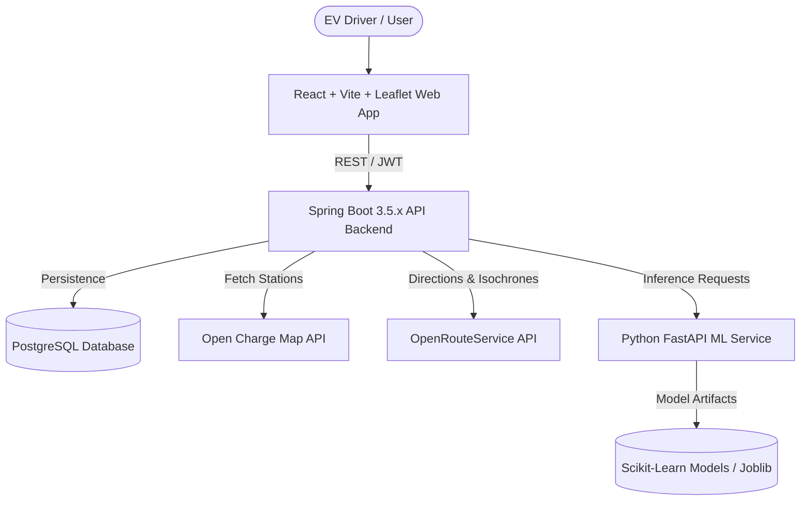

# VoltRoute: Project Overview

## 1. Executive Summary

**VoltRoute** is an AI-powered Electric Vehicle (EV) Charging Station Finder and Intelligent Route Optimization Platform. The platform addresses fundamental challenges in modern EV mobility: range anxiety, unpredictable charger occupancy, fragmented station data, connector incompatibilities, and suboptimal long-distance journey planning.

By combining real-time global charging station directories (such as [Open Charge Map](https://openchargemap.org/)), advanced spatial routing algorithms (such as [OpenRouteService](https://openrouteservice.org/)), and machine learning models for wait-time prediction and dynamic energy consumption modeling, VoltRoute empowers EV drivers to plan multi-stop trips with guaranteed charging halts aligned with their specific vehicle's battery profile.

---

## 2. Problem Statement & Value Proposition

### 2.1 The Core Problem
1. **Range Anxiety & Estimation Gaps**: Standard navigation systems compute routes based on shortest distance or travel time for combustion engines, neglecting EV discharge curves, vehicle payload, temperature variations, and elevation gain.
2. **Charger Compatibility & Quality Variance**: Drivers frequently arrive at stations only to discover non-functional chargers, incompatible connector standards (e.g., CCS2 vs. CHAdeMO vs. Type 2), or occupied stalls.
3. **Queue Latency**: Lack of predictive wait-time analytics leads to bottleneck queues at popular charging hubs along highways.
4. **Fragmented Ecosystem**: Station operators maintain proprietary, isolated platforms, making multi-network discovery difficult.

### 2.2 The VoltRoute Solution
* **Unified Discovery**: Aggregates station metadata, connector types, power ratings (kW), and pricing into a single interactive map interface.
* **Vehicle-Specific Route Optimization**: Calculates the optimal route considering starting State of Charge (SoC), target arrival SoC, battery degradation profile, and recommended charging halts.
* **Predictive Intelligence**: Machine learning service predicting station wait times, queue delays, and real-world charging duration based on historical usage patterns.
* **Community-Driven Verification**: Crowd-sourced user ratings, reviews, and check-in statuses to ensure charger operational truth.

---

## 3. User Personas

| Persona | Core Needs | Pain Points | Primary VoltRoute Features Used |
| :--- | :--- | :--- | :--- |
| **Daily EV Commuter** | Fast nearby charger lookup, accurate availability, pricing comparison. | Arriving at slow or broken chargers during workday routines. | Station Finder, Radius Filter, Real-time status, Quick navigation. |
| **Long-Distance Road Tripper** | Multi-stop routing with scheduled charging halts and minimal overall trip time. | Running out of battery between distant highway exits. | Intelligent Route Optimizer, Elevation-aware energy consumption engine, Waypoint scheduling. |
| **Fleet Operator** | Vehicle profile management, route efficiency, cost tracking. | Unplanned downtime and expensive peak-demand charging stops. | Vehicle management, Route history, Preferred network filtering. |
| **Community Contributor / Admin** | Moderation, reporting faulty stations, adding operational reviews. | Stale station data across third-party directories. | Station Reviews, Check-ins, System moderation panel. |

---

## 4. System Capabilities & Functional Scope

### 4.1 Implemented & Planned Capabilities Matrix

| Functional Module | Capability Description | Current State | Target Phase |
| :--- | :--- | :--- | :--- |
| **Authentication & Profiles** | User registration, JWT login, vehicle garage (model, battery capacity, connector type). | Greenfield (Missing) | Phase 2 |
| **Station Discovery** | Geospatial bounding box/radius queries, connector filtering, Open Charge Map integration, local station caching. | Greenfield (Missing) | Phase 3 |
| **Interactive Map & Web UI** | Responsive React UI, Tailwind CSS, Leaflet map with custom EV charger markers, route polylines, search filters. | Greenfield (Missing) | Phase 4 |
| **Route Optimization Engine** | Waypoint-aware pathfinding via OpenRouteService, battery consumption heuristic, charging stop insertion algorithm. | Greenfield (Missing) | Phase 5 |
| **Community & Reviews** | Station check-ins, 1-5 star ratings, feedback comments, bookmarking favorite stations. | Greenfield (Missing) | Phase 6 |
| **AI Wait-Time & Charging ML** | FastAPI microservice predicting queue wait time and charging speed based on station history and hour-of-day. | Greenfield (Missing) | Phase 7 |
| **Observability & Docs** | SpringDoc OpenAPI (Swagger UI), health checks via Spring Boot Actuator, structured logging. | Greenfield (Missing) | Phase 1 & 8 |

---

## 5. Target Technology Stack Specifications (Planned Dependencies)

> [!NOTE]
> The repository is currently greenfield. The specifications below define the target architectural standards and dependency baselines to be scaffolded during Phase 0 and subsequent phases. No dependency manifests (`pom.xml`, `package.json`, `requirements.txt`) exist in the repository prior to Phase 0.

### 5.1 Planned Frontend Client
* **Framework**: React 18+ / Vite
* **Language**: JavaScript (ES2023+)
* **Styling**: Tailwind CSS
* **Navigation**: React Router v6 / v7
* **HTTP Client**: Axios (to be configured with request/response interceptors for JWT bearer tokens)
* **GIS & Mapping**: Leaflet and React Leaflet (OpenStreetMap tiles, custom SVG EV pin markers, dynamic route polylines)

### 5.2 Planned Backend API Service
* **Platform**: Java 21 LTS (Oracle JDK 21.0.11 verified on host)
* **Framework**: Spring Boot 3.5.x (or 3.4.x LTS baseline, available on Maven Central)
* **Build Tool**: Apache Maven 3.9+ (Maven 3.9.16 verified on host)
* **Security**: Spring Security 6 with stateless JWT (JSON Web Token) authentication filter chain
* **Persistence & ORM**: Spring Data JPA & Hibernate 6
* **Database**: PostgreSQL 18.x with PostGIS capability (or standard relational spatial queries via bounding-box indices)
* **API Documentation**: SpringDoc OpenAPI 2.x (Swagger UI at `/swagger-ui.html` and OpenAPI JSON at `/v3/api-docs`)

### 5.3 Planned External Integrations
* **Open Charge Map API**: Ingestion of global public EV charging station metadata (coordinates, operator names, connector types, power ratings, usage costs).
* **OpenRouteService API**: Calculation of driving routes, distances, durations, elevation geometry, and step-by-step directions.

### 5.4 Planned Machine Learning Microservice (Future Integration)
* **Runtime**: Python 3.14+ / 3.12+ (Python 3.14.7 verified on host)
* **Framework**: FastAPI + Uvicorn
* **Libraries**: scikit-learn, NumPy, Pandas, Joblib
* **Role**: Station occupancy estimation, queue latency regression, and non-linear EV charging rate estimation based on battery State-of-Charge (SoC) curves.

---

## 6. Local Host Environment Verification

A local environment audit was performed on the host operating system (Windows 11 x64):

* **Java Development Kit**: `Java 21.0.11 LTS` (Oracle Corporation) — Verified working.
* **Java Compiler**: `javac 21.0.11` — Verified working.
* **Apache Maven**: `Maven 3.9.16` — Verified working.
* **Node.js**: `v24.13.1` — Verified working.
* **npm**: `11.8.0` — Verified working.
* **Python**: `3.14.7` — Verified working.
* **PostgreSQL Engine**: `psql 18.4`, Windows Service `postgresql-x64-18` (Status: `Running`). *Note: Database instance credentials and dedicated VoltRoute schema creation will be established in Phase 1.*
* **Docker Daemon**: Docker 29.7.2 CLI installed; daemon currently stopped.

---

## 7. Next Steps

Refer to [ARCHITECTURE.md](file:///c:/Users/Ayush/Desktop/voltroute/docs/ARCHITECTURE.md) for architectural topology, database schema design, and security models, and [IMPLEMENTATION_PLAN.md](file:///c:/Users/Ayush/Desktop/voltroute/docs/IMPLEMENTATION_PLAN.md) for the phased engineering roadmap.
